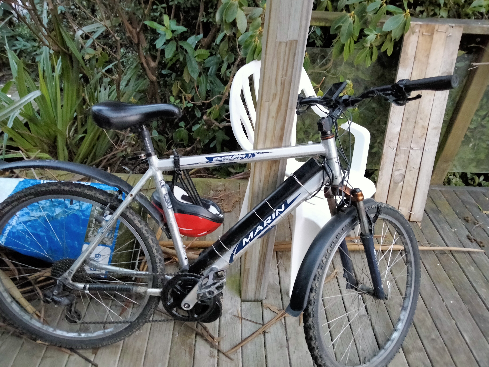

# First E-bike

36V/500W (peaked 750W) mid-drive conversion on an old bike. Kit ~$1000, battery a $50 e-scooter pack. Wired BMS, motor, screen; worked.

## Specs

- 36V, 500W (peaked 750W)
- Mid-drive motor

## Photos

