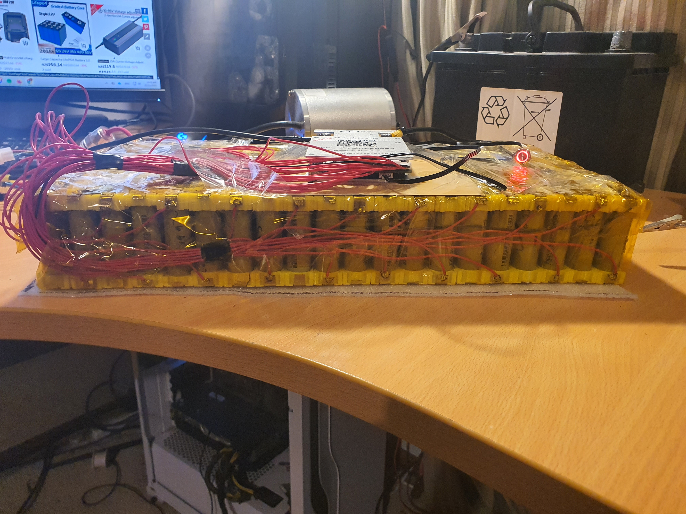
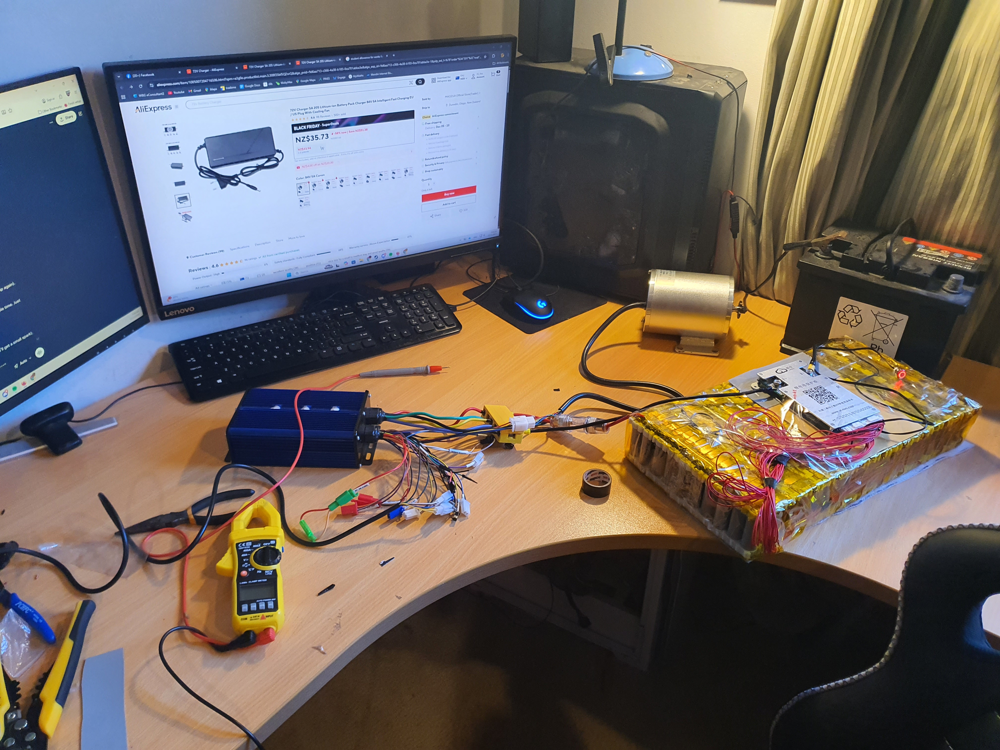
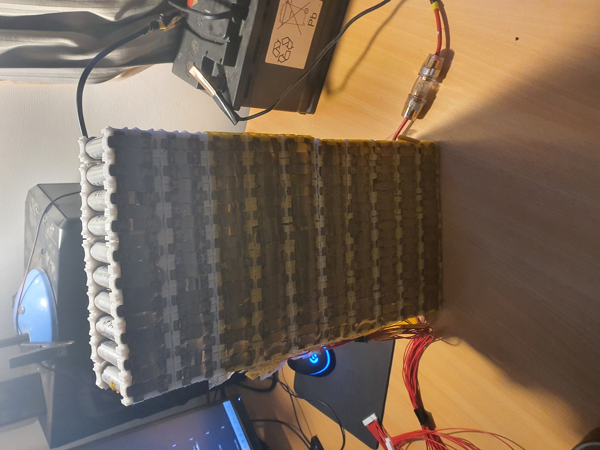
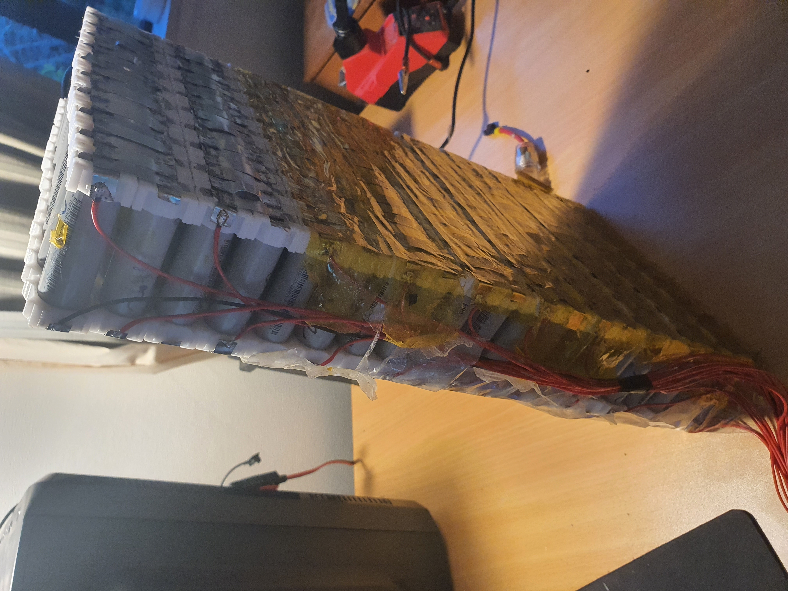
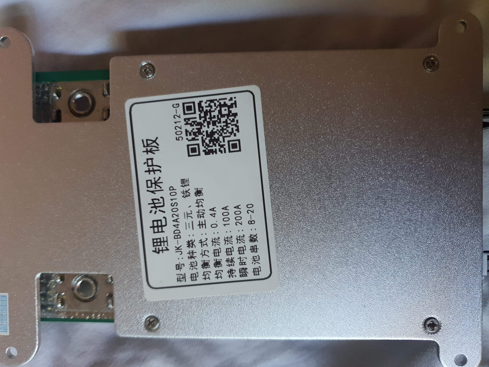
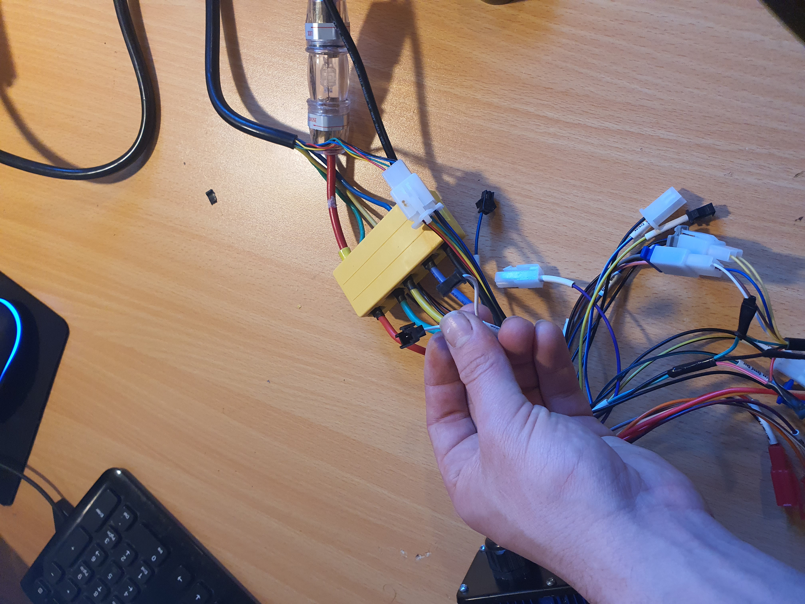
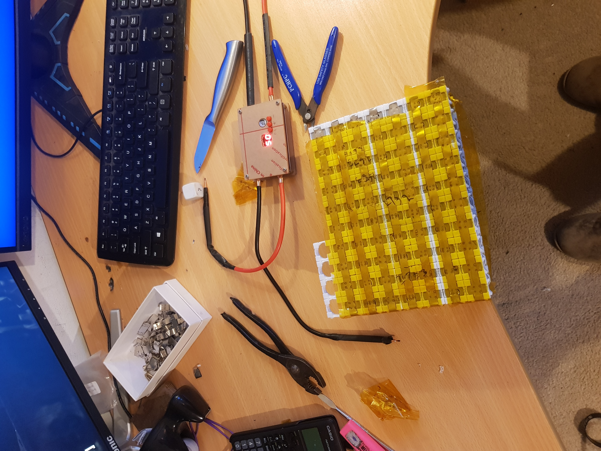

# 72V 3kW Go-Kart Battery Pack

20S10P pack from recycled 18650 cells (3×36V e-bike packs, ~$50 each). ~$250 NZD vs $600–1000 bought.

## Build

- Recycled cells from e-bike packs; first tried 2×36V in series (unreliable, unsafe), then rebuilt as 20S10P.
- V1 taped (unsafe, no cooling). V2: 3D-printed holders with air gaps for isolation/cooling.
- Spot welding: homemade welder (car battery + MOSFETs) failed after ~3 welds each; bought a $25 unit. Nickel 0.3×15 mm series / 0.10×15 mm parallel, sized from current calcs. Truck battery used as power source to spare car battery.
- Incident: dropped nickel strip across groups → shorted/white-hot; grabbed bare-handed, burned fingers; no cell damage; taped off unused areas after.
- Bluetooth BMS (~$40): per-group voltage, remote cutoff, charge limits.

## First power-up

[Battery first power-up video](media/first-power-up.mp4)

## Photos

