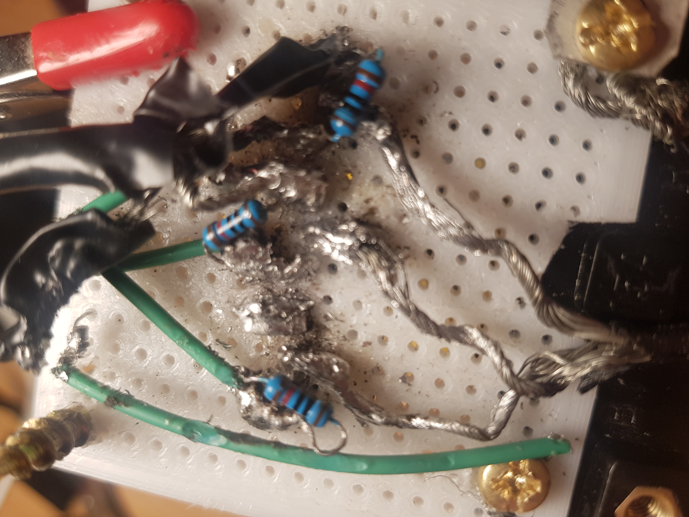

# Homemade Spot Welder

Spot welder built from a car battery + MOSFETs from a dead e-bike controller, for the kart battery pack. Copper probes on a stick, mechanical switch triggering the MOSFETs to short the battery briefly. Welded thin nickel but blew MOSFETs after ~3 welds each; unreliable. Bought a $25 AliExpress unit instead. MOSFETs from a dead e-bike controller.

